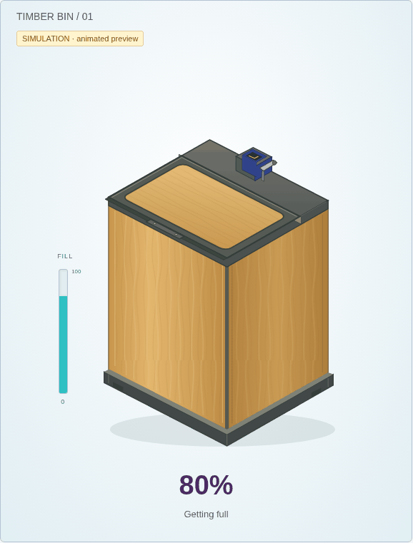
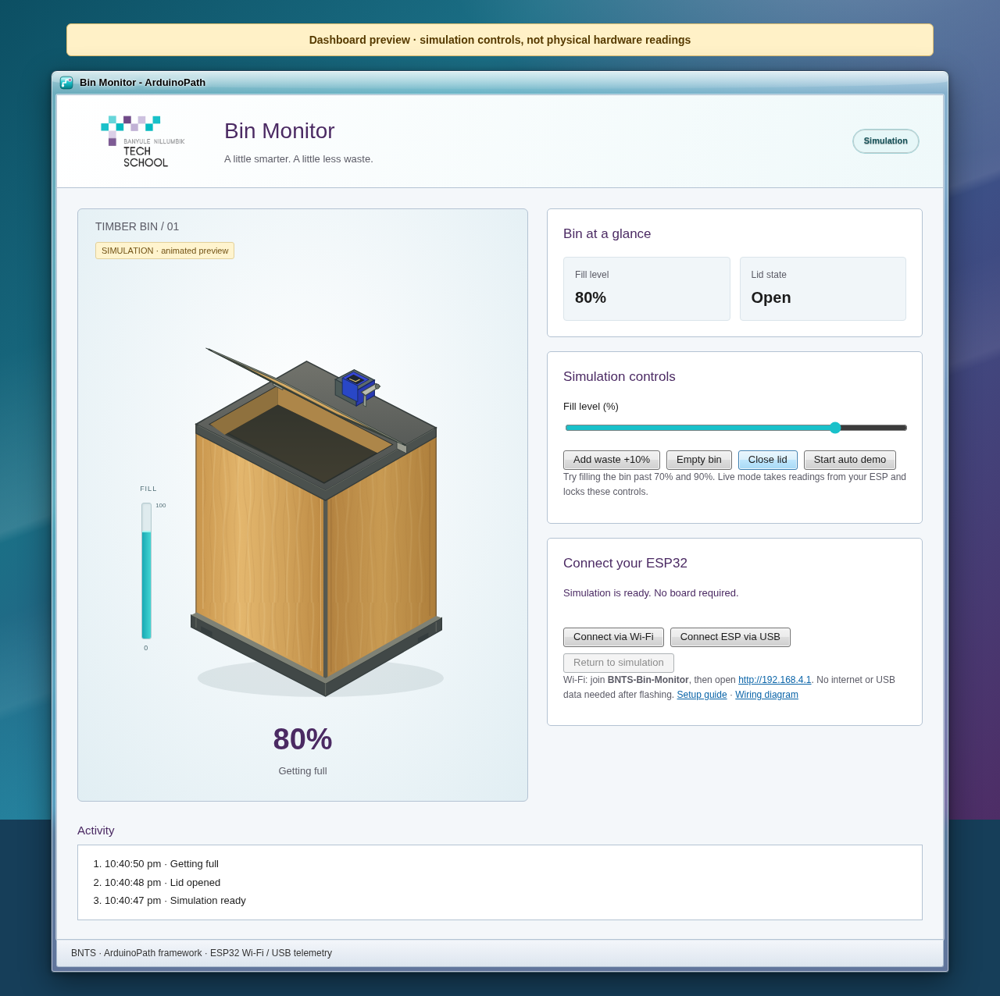
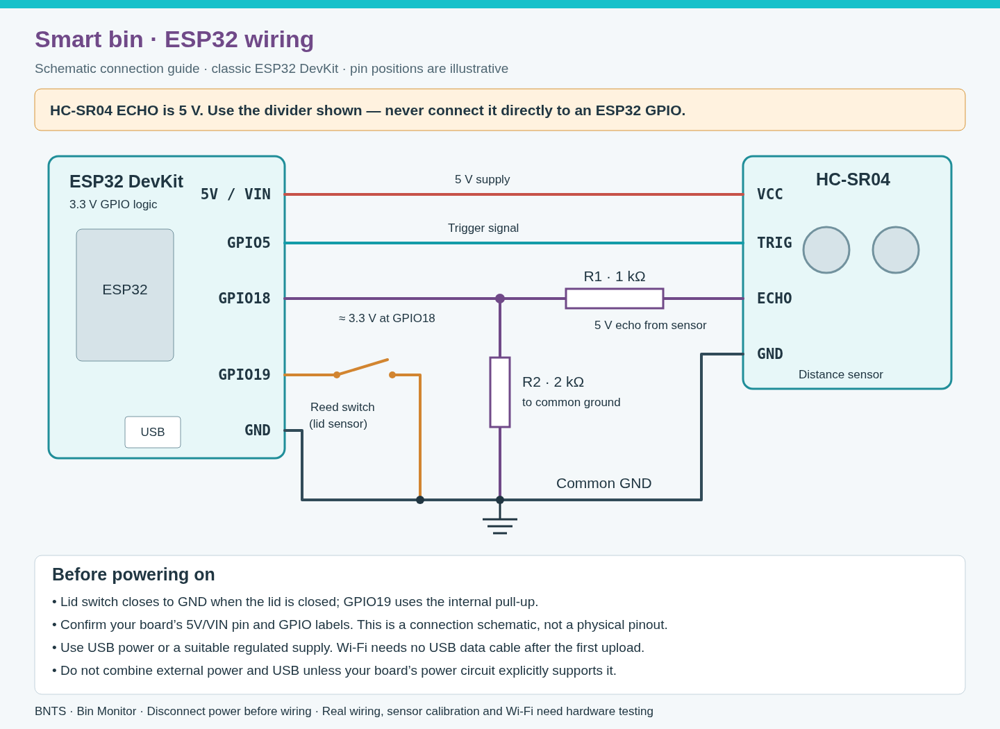

# Timber bin monitor sandbox

The bin illustration follows the supplied timber-box CAD design and opening video: honey-coloured wooden panels, charcoal top/base frames, a rear servo and an independently hinged flap. The fill reading appears in a separate teal gauge so the wood remains opaque. ArduinoPath’s framework, theme and official school logo are retained.

## Animated lid preview

Actual browser-rendered frames from the dashboard, using simulation inputs. The preview shows the lid opening, closing and opening again around its fixed rear hinge.



[Open animated preview](lid-animation.gif)

## Dashboard

These are actual browser screenshots with clearly labelled simulation readings. They are not image-generator mockups or evidence of a physical ESP32 connection.



[Open lid screenshot](dashboard.png) · [Closed lid screenshot](dashboard-closed.png) · [Mobile screenshot](dashboard-mobile.png)

## Run and develop

The complete runnable prototype, tests, self-contained artwork and ESP32 firmware are in [dashboard/](dashboard/README.md).

From the ArduinoPath repository root:

```sh
npm ci
cd SANDBOX/bin-monitor/dashboard
npm test
npm start
```

The development server listens on port 8090. With the server running, `node tests/bin-view-browser.mjs` checks lid motion, fixed hinge, fill indicator, mobile fit and reduced-motion behaviour, and captures screenshots plus an animated GIF. Browser tests need Chromium at `/usr/bin/chromium` in this cloud environment. See the prototype README for Wi-Fi/USB checks and embedding the updated assets into the ESP32 firmware.

The pictured servo is a visual reference to the prototype. The current firmware reports the lid switch; it does not command a servo or move the physical lid.

## ESP32 wiring

Connection schematic for a classic ESP32 DevKit, HC-SR04 ultrasonic distance sensor and reed-switch lid sensor. Check your board’s pin labels; this is not a physical pinout.



[Open wiring image](wiring.png) · [Scalable SVG](wiring.svg)

The HC-SR04 ECHO signal is 5 V. It must pass through the shown divider: ECHO → 1 kΩ → GPIO18 junction; junction → 2 kΩ → GND. Never connect 5 V ECHO directly to ESP32 GPIO. GPIO5 drives TRIG; GPIO19 reads the switch to ground, closed when the lid is closed.

## Validation status

Browser checks passed for simulation controls, Wi-Fi polling through intercepted HTTP, fill and lid animation, stale/invalid readings, reconnect, school-logo loading and mobile layout. The dashboard assets were checked against the firmware-embedded payload.

Still unverified: firmware target compilation/upload, actual phone/laptop association with the ESP32 Wi-Fi network, on-board HTTP serving, power stability, divider voltage, physical sensor calibration and lid-switch operation. Cloud firmware compilation was blocked by package-download network restrictions. After flashing, the intended Wi-Fi flow is to power the board, join BNTS-Bin-Monitor, stay connected despite no internet, and manually open http://192.168.4.1. USB data is not required for that flow.
