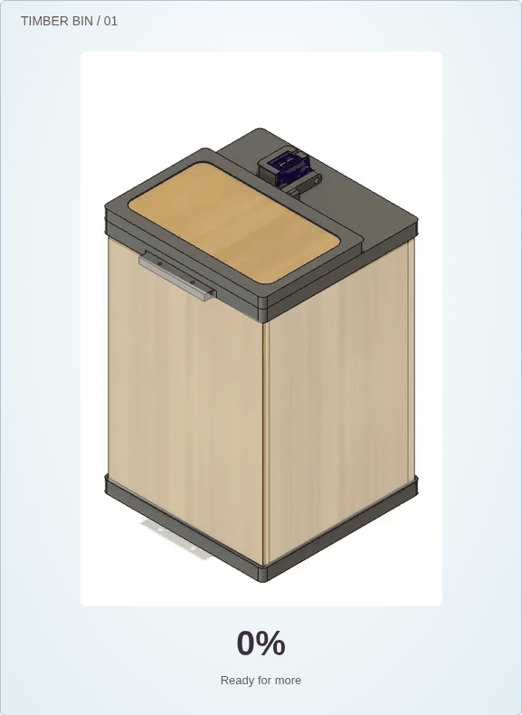

# Uno bin controller and ESP32-C3 Wi-Fi relay

The Uno runs the complete bin using the supplied working Grove-ultrasonic program, with an added internal capacity sensor. The ESP32-C3-Zero only receives and relays the Uno’s completed readings. The original pins, button homing, fixed five-second opening cycle and servo relaxation are preserved.

## The two programs

- [Uno controller sketch](dashboard/firmware/uno_bin_controller/uno_bin_controller.ino) — original lid control plus internal capacity sensing. Keep its supporting headers in the same sketch folder.
- [Uno setup and calibration](dashboard/firmware/uno_bin_controller/README.md).
- [ESP32-C3-Zero Wi-Fi relay sketch](dashboard/firmware/esp32_c3_wifi_bridge/esp32_c3_wifi_bridge.ino) — RX-only UART, checked data forwarding, access point and dashboard server. Keep its headers alongside it.
- [Complete wiring, flashing, protocol and test guide](dashboard/README.md).

## One data signal and common ground

Uno D1/TX → 2.2 kΩ → C3 GPIO4 junction; junction → 3.3 kΩ → common ground. Join Uno and C3 grounds. No C3 TX connection is needed. Never connect the Uno’s 5 V TX directly to the C3. Power and common ground are still required in addition to the one data signal.

The existing Uno pins stay D2 closure button (active HIGH), D3 servo, D7 Grove approach sensor and D8 LED. Add a Grove capacity sensor on D6. A configurable HC-SR04 capacity alternative uses D5 TRIG and D6 ECHO.

[Open wiring PNG](wiring.png) · [Scalable SVG](wiring.svg)

## Your model animation

The dashboard uses actual frames from the user-supplied CAD opening video, not a replacement drawing or generated model. Opening plays those frames forward and holds the last frame; closing reverses the same frames and holds the first. It can reverse direction part-way through. The timber panels are now translucent, with scrunched paper balls rising inside the bin as the live Uno fill reading increases. The original frame, servo and lid stay opaque. The bin sits in a white square; beside it are the lid state (OPEN blue, CLOSED green, MOVING orange) and a green-to-red fill bar, with the controls on a Settings tab. The pile is a capacity illustration rather than a measured paper-ball count. The source MP4 is retained in `dashboard/assets/source/` with its checksum in the frame manifest. Inline GIF messages did not expose a downloadable original GIF; the tooling also accepts a source GIF when that file is available.

[Open lid animation](lid-animation.gif) · [Watch the bin fill with paper](fill-animation.gif)

## Dashboard preview

These are actual browser captures with simulation inputs, not proof of hardware connectivity.

[Empty bin](paper-empty.png) · [Half-full bin](paper-half.png) · [Full bin](paper-full.png)

[Open image](dashboard.png) · [Closed image](dashboard-closed.png) · [Mobile layout](dashboard-mobile.png)

## Validation and hardware limits

Passed JavaScript telemetry tests, browser tests for source-frame playback and Uno/Wi-Fi data handling, and host C++ tests of the actual controller and relay code. Host tests include the original lid sequence, invalid capacity readings, serial corruption, stale data and an unplugged radio.

AVR/ESP32-C3 target compilation is not yet verified: this cloud environment blocked the required board-package downloads. Real testing is still needed for flashing, startup/closing servo calibration and switch polarity, sensor cross-talk/capacity calibration, voltage divider and grounding, power stability and C3 Wi-Fi/HTTP. Follow the flash-partition guidance for the embedded display assets.

After flashing, join BNTS-Bin-Monitor and open http://192.168.4.1. The Uno controls the bin without Wi-Fi; dashboard simulation controls never command the real hardware.
